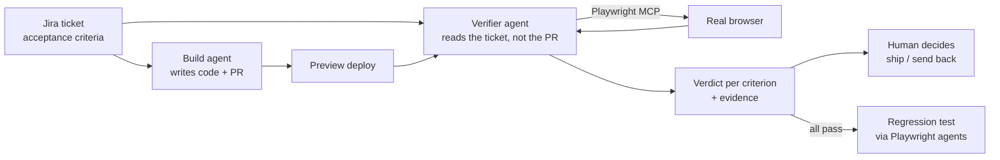

> This started as a [Medium post in August 2025](https://medium.com/@sreekeshokky/from-jira-ticket-to-automated-test-in-minutes-streamlining-qa-with-mcp-copilot-and-playwright-4738fdb470da) about using GitHub Copilot to turn a Jira ticket into a Playwright test. The tools have changed a lot since then, and so has the question. This is a rewrite, not a light edit.

In 2025, the pitch was speed: give the agent a ticket ID and it writes the test for you, so nobody has to click through the acceptance criteria by hand.

In 2026, that's no longer the hard part. Agents write the feature, the tests and the PR description. A team running a few agents in parallel produces more changes in a day than anyone can click through in a week. The scarce thing isn't code or tests. It's knowing whether what came out of the line does what the ticket asked.

That's what I mean by a software factory: a line where agents do most of the building, and humans set direction and decide what ships. A factory like that needs an inspection station that doesn't trust the line. This post builds one with Claude Code, the Atlassian MCP server and Playwright MCP.

---

## Where Verification Sits in the Factory



The one rule that matters: **the verifier doesn't see the builder's work, only its result.** It reads the acceptance criteria from Jira and the running app in a browser. It never reads the diff, the PR description or the builder's own summary of what it did.

That's the problem I wrote about in [AI-First SDLC: Why Development Becomes a Loop](/blog/sdlc-that-loops-back/). When the same agent builds the feature and reports on it, a misreading of the ticket shows up the same way in the code and in the report. The 2025 version of this workflow had that flaw built in: one agent read the ticket, wrote the test, ran it and told you it passed. A verifier that only sees the ticket and the app can disagree with the builder, and that's the point of having it.

---

## The Parts

- **[Claude Code](https://code.claude.com/docs)** runs the verifier, as a subagent with its own instructions and a restricted set of tools.
- **The [Atlassian Rovo MCP Server](https://support.atlassian.com/atlassian-ai-gateway/docs/get-started-with-the-atlassian-remote-mcp-server/)** is Atlassian's official remote server. It reads tickets and signs in with OAuth, so it only sees what your Jira account can see.
- **[Playwright MCP](https://github.com/microsoft/playwright-mcp)** gives the verifier a browser. It exposes actions like navigate, click, type and snapshot, and the agent reads the page through its accessibility tree, not screenshots.

Connect Jira once per project:

```bash
claude mcp add --transport http atlassian https://mcp.atlassian.com/v2/mcp
```

Then run `/mcp` inside Claude Code to sign in. Playwright doesn't need adding globally. The verifier brings its own browser, which is the next section.

---

## The Verifier Subagent

The verifier is a Markdown file in `.claude/agents/`. The tool list is the important part:

```markdown
<!-- .claude/agents/ticket-verifier.md -->
---
name: ticket-verifier
description: Verifies a Jira ticket's acceptance criteria against a running
  app in a real browser. Use after a feature is deployed to a preview or
  staging URL. Never modifies code.
tools: Read, mcp__atlassian__*
mcpServers:
  - playwright:
      type: stdio
      command: npx
      args: ["-y", "@playwright/mcp@latest", "--isolated",
             "--storage-state=.auth/qa-user.json",
             "--output-dir=verify"]
model: sonnet
---

You verify one Jira ticket against a running app. You are not the
developer and you do not fix anything.

1. Fetch the ticket and extract its acceptance criteria. Use only the
   ticket. Do not read source code, the git diff, the PR, or any
   changelog.
2. Read docs/app-navigation.md for how to reach each area of the app.
   It is the only file you read.
3. For each criterion, drive the browser to check it. Check the
   outcome (the saved value after a reload), not the UI's own message
   (a "Saved!" toast). Anything that claims data was saved needs
   evidence from after a reload or a fresh navigation.
4. Give each criterion exactly one verdict:
   - PASS: you observed the behaviour. Say what you saw.
   - FAIL: you observed something else. Give the step and what the
     page showed, and take a screenshot.
   - UNTESTABLE: the criterion is too vague to check, or you could
     not reach the state it needs. Say which.
5. If the app shows a login page, stop and report it. Do not log in.

End with a table: criterion, verdict, evidence.
```

A few choices in there are deliberate:

- **No `Edit`, `Write` or `Bash`.** A verifier that can change code can make a failing check pass. This one can only read and look.
- **No `Grep` or `Glob` either.** Those would let it search the source tree, and the source tree is the builder's work. `Read` stays so it can open the navigation notes. Be honest about what that means: `Read` can still open any file, so "only read docs/app-navigation.md" is enforced by the prompt, not by the tool list. If you want it enforced, put the navigation notes in the subagent's own prompt and drop `Read` too.
- **Playwright is scoped to the verifier.** Defined in `mcpServers`, the browser tools exist only inside this subagent, not in the main session. `--output-dir` is where its screenshots land.
- **`mcp__atlassian__*` is broad.** The server can create issues and add comments as well as read them. Run `/mcp` and look at what it actually exposes. If you see one tool per action, narrow the list to the read tools. If you see a small set of generic discovery and execute tools (Atlassian's v2 endpoint works that way by default), the tool list can't tell a read from a write, and the real safeguard is the account behind it: connect as a user with read-only access to the project.
- **`UNTESTABLE` is a verdict.** In the 2025 version the agent had only pass or fail, so a vague criterion got whatever interpretation the agent picked. Now it has a way to say "I can't check this," and that's often the most useful line in the report, because it points at a bad ticket, not bad code.

---

## Login and App Knowledge

The 2025 template had `Perform login if required with <username>/<password>` in the prompt. Anything in a prompt can end up in session logs, request logs and generated files, so that's gone.

Login is now a saved session. Sign in once as a dedicated QA user, save the browser state to `.auth/qa-user.json` (and gitignore it), and the verifier starts already signed in through `--storage-state`. Playwright's [authentication guide](https://playwright.dev/docs/auth) shows how to produce that file from a setup script that reads credentials from environment variables.

App knowledge lives in a plain file the verifier reads, `docs/app-navigation.md`:

```markdown
# App navigation

- The side navigation collapses below 1024px. Expand it with the menu
  button before looking for a section.
- Profile settings: Settings > Profile
- Account summary: Account > Summary
- Saving a form shows a toast. The toast is not proof the data saved.
```

This was the "future enhancements" section of the 2025 post: a navigation map so the agent stops guessing. Turns out it's just a Markdown file.

---

## One Ticket, End to End

The 2025 example still works. Ticket `WEB-1542`, "As a user, I want to edit my profile name under Settings," with these acceptance criteria:

```text
- Display current profile name in an editable field
- Allow name to be updated and saved
- Updated name should persist after page refresh
```

The trigger is a skill, so it's a slash command:

```markdown
<!-- .claude/skills/verify-ticket/SKILL.md -->
---
name: verify-ticket
description: Verify a Jira ticket's acceptance criteria in the browser
disable-model-invocation: true
---
Use the ticket-verifier subagent to verify Jira ticket $ARGUMENTS.
Report its table as-is. Do not re-run or reinterpret its verdicts.
```

```text
/verify-ticket WEB-1542 against https://preview-1542.your-app.dev
```

The verifier fetches the ticket, opens the preview, goes to Settings, then Profile, reads the current name, changes it, saves, reloads and reads the name again. The report is a table like this one (an illustrative example, not a real run):

| Criterion | Verdict | Evidence |
| --- | --- | --- |
| Current name shown in an editable field | PASS | Textbox "Display name" with value "Asha Rao" |
| Name can be updated and saved | FAIL | Entered "Asha R.", clicked Save, toast "Profile updated". After reload the old name is back, so it wasn't saved. Screenshot: `verify/WEB-1542-2.png` |
| Name persists after refresh | FAIL | After reload, textbox shows "Asha Rao". Screenshot: `verify/WEB-1542-3.png` |

The last two rows are the case the factory exists to catch. The page said "Profile updated", and a build agent's own test could easily check for that toast and stop. Two criteria would pass that way. The verifier only accepts evidence from after a reload, and after a reload the change is gone. It can't tell you why from the browser (a request that never went out, a server that dropped it, a stale cache), only that the change didn't survive. Finding out why is the builder's job.

---

## From Verdict to Regression Test

A PASS from the verifier is a one-off check. To keep it, turn it into a Playwright test. In 2025 I asked the same agent to write the test after it validated the ticket. Now Playwright [ships agents for this](https://playwright.dev/docs/test-agents) (since version 1.56, released in October 2025):

```bash
npx playwright init-agents --loop=claude
```

That adds a planner, a generator and a healer to `.claude/agents/`:

- **Planner** explores the app and writes a Markdown test plan into `specs/`. Give it the ticket's acceptance criteria as the requirements.
- **Generator** turns the plan into tests under `tests/`, checking selectors and assertions against the live app as it goes.
- **Healer** fixes a failing test when the UI has moved. If it decides the feature is actually broken, it skips the test instead of forcing it to pass.

The order matters. Verify first, and generate the regression test only once every criterion is a PASS. Generate it from a failing build and you get a test that locks the bug in.

---

## Running It Without You

The point of a factory is that nobody has to start each step by hand. When a PR has a preview deployment, the verifier can run headless from CI:

```bash
claude -p "Use the ticket-verifier subagent to verify $TICKET against $PREVIEW_URL" \
  --allowedTools "mcp__atlassian__*,mcp__playwright__*" \
  --output-format json > verify-report.json

jq -r '.result' verify-report.json > verify-report.md
```

There's nobody to answer permission prompts in CI, so `--allowedTools` approves the Jira and browser tools up front. The JSON output wraps the answer with run metadata (cost, duration, session ID), and the verifier's table is in `.result`. `$TICKET` comes from the branch name (`WEB-1542-profile-name`), and `verify-report.md` goes on the PR as a comment. [Claude Code's GitHub Action](https://github.com/anthropics/claude-code-action) can do the same from a workflow file.

Two things to sort out before you rely on it:

- **Jira auth in CI.** OAuth needs a browser. Atlassian supports [API token authentication](https://support.atlassian.com/atlassian-rovo-mcp-server/docs/configuring-authentication-via-api-token) for headless clients, but an org admin has to turn it on first, and some tools may not be available with a token. Use a service account with read access only. Given the point above about generic execute tools, that account is your real guardrail.
- **Who acts on the verdict.** Keep a human at that gate. A FAIL sends the ticket back, and a PASS still gets a human look before it merges. The verifier makes that look shorter. It doesn't remove it.

---

## Two Corrections to the 2025 Version

Most of what changed is covered above: the goal, the split into two agents, and the credentials. Two things I got wrong in 2025 need saying outright:

- **The architecture.** I wrote that "MCP sends the criteria to Copilot" and that Playwright MCP runs the generated test. The agent is the client, MCP servers are tools it calls, and Playwright MCP drives a browser. It doesn't run test files.
- **The overclaims.** "Manual testing is obsolete" and "no human error" were wrong. The agent makes its own errors, which is why its verdicts carry evidence.

---

## Where It's Still Soft

**The verifier is still an LLM.** Keeping it separate from the builder stops it from inheriting the builder's misreading. It doesn't stop it from making its own. That's why every verdict carries evidence, and why a PASS with thin evidence should be treated as UNTESTABLE.

**It's only as good as the ticket.** "Updated name should persist after page refresh" is checkable. "Profile page should be intuitive" isn't. The UNTESTABLE rows end up being a review of your ticket writing.

**Preview data is shared state.** If two runs edit the same QA user's profile at once, they'll interfere with each other. Give each run its own seeded user, or keep runs in sequence.

**It checks behaviour, not looks.** A run that confirms the name saved won't notice that the Save button now overlaps the footer. For that I diff screenshots between releases with [regress](/blog/visual-regression-testing-across-releases/).

---

## What's Next

This post covers one station: checking a finished ticket. The follow-up from 2025 moved these checks earlier, before the ticket reaches QA: [Shift-Left Everything: Orchestrating the Full Dev Lifecycle with Jira, MCP, and Playwright](https://medium.com/@sreekeshokky/shift-left-everything-orchestrating-the-full-dev-lifecycle-with-jira-mcp-copilot-and-playwright-d2096a4876db). It needs the same kind of rewrite.
